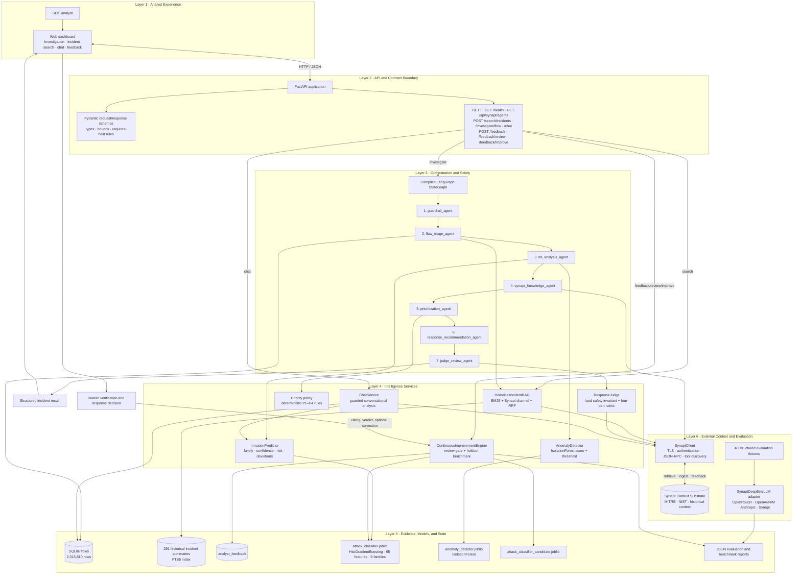
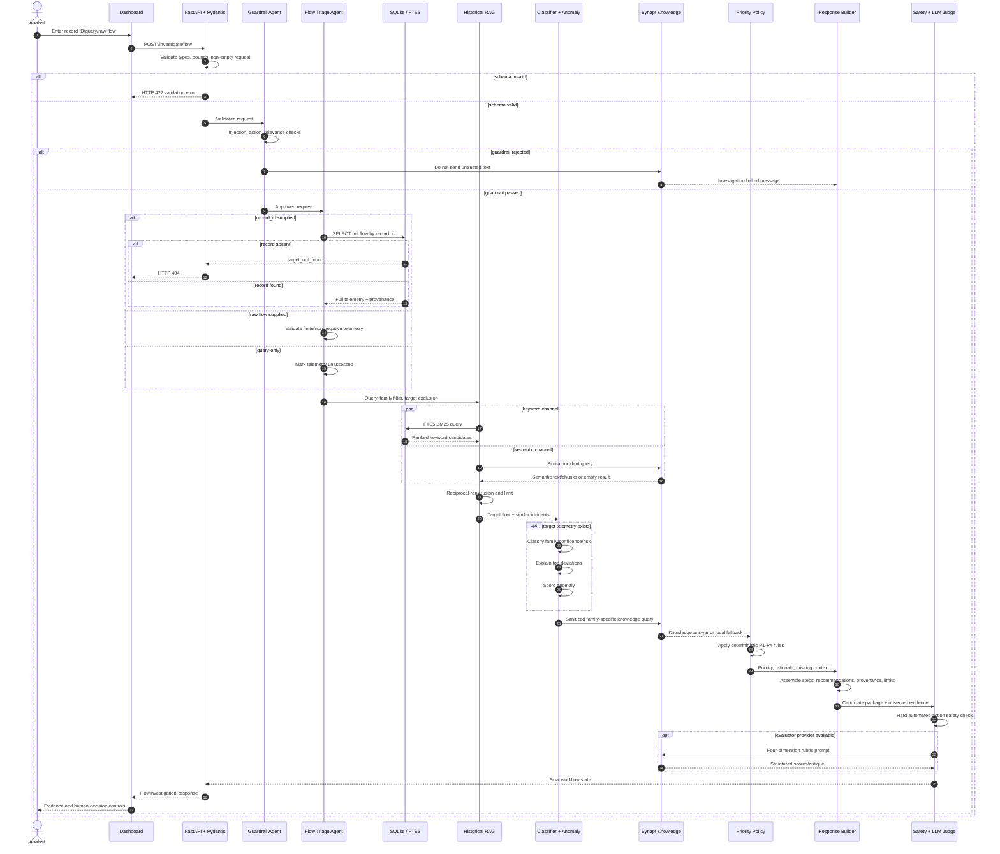
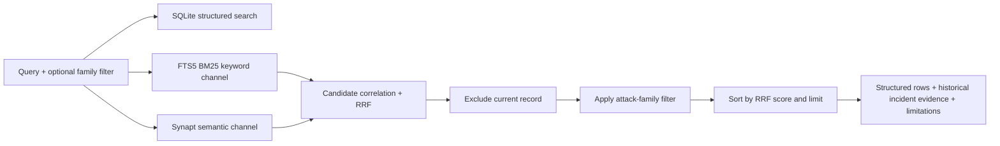
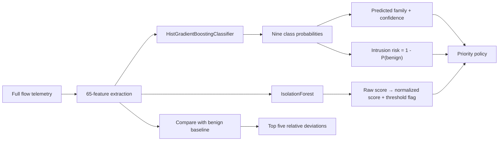
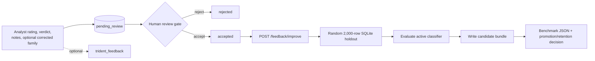
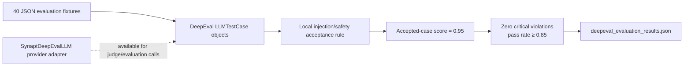

# CyberSentinel Copilot — Detailed Architecture and Step-by-Step Flow

This document is the technical reference architecture for the implemented project. It shows the system as six layers, then follows a single investigation from analyst input through guardrails, retrieval, prediction, prioritization, response generation, judge validation, presentation, and reviewed feedback.

The dedicated module ownership and Synapt-role alignment view is available in [`MODULE_WISE_SYNAPT_ARCHITECTURE.md`](MODULE_WISE_SYNAPT_ARCHITECTURE.md).

## 1. Layered component architecture

## 2. Complete investigation flow

| Step | Input | Component | Processing | Output / next state |
|---:|---|---|---|---|
| 0 | Analyst record ID, query, family, protocol, or raw flow | Dashboard | Collects the investigation request and current flow context | JSON request to FastAPI |
| 1 | HTTP request | FastAPI + Pydantic schemas | Enforces field types, ranges, length limits, and non-empty investigation request | Validated `FlowInvestigationRequest`, or HTTP 422 |
| 2 | Validated request | `guardrail_agent` | Checks prompt injection, destructive instructions, prohibited automated containment, and query-only cybersecurity relevance | `guardrail_status` and optional violation |
| 3 | Approved request | `flow_triage_agent` | Loads exact record, validates supplied telemetry, enforces missing-record 404, and requests historical incidents | `target_flow`, `similar_flows`, `target_not_found` |
| 4 | Query + optional target flow | `HistoricalIncidentRAG` | Runs FTS5/BM25 keyword retrieval and Synapt semantic retrieval, correlates candidates with RRF, applies family filter, excludes the target record | Ranked historical incident summaries |
| 5 | Target telemetry | `ml_analysis_agent` | Runs nine-family classifier, calculates confidence and `1 - P(benign)` risk, extracts five benign-baseline deviations, runs IsolationForest | Classification, risk, severity, explanations, anomaly result, MITRE mapping |
| 6 | Predicted family + sanitized analyst context | `synapt_knowledge_agent` | Queries Synapt for investigation procedures, ATT&CK indicators, and verification steps; uses local degradation message if unavailable | Knowledge evidence and analysis text |
| 7 | Prediction + anomaly + telemetry context | `prioritization_agent` | Applies explicit P1–P4 rules for DoS/DDoS, infiltration, brute force, web attack, botnet, port scan, anomaly, and benign traffic | Priority code, rationale, missing context |
| 8 | All evidence and priority | `response_recommendation_agent` | Builds analyst investigation steps and response drafts; attaches model, record, provider provenance and dataset/safety limitations | Candidate incident response package |
| 9 | Candidate response + observed telemetry | `judge_review_agent` | Enforces hard no-auto-containment invariant, then evaluates grounding, action safety, NIST alignment, and relevance | Pass/fail, composite score, dimension scores, critique, unsupported claims |
| 10 | Final LangGraph state | FastAPI response mapper | Maps optional and required fields into `FlowInvestigationResponse` | Structured JSON response |
| 11 | JSON response | Dashboard | Renders assessment, evidence, similar incidents, MITRE, actions, provenance, limitations, and judge verdict | Analyst review |
| 12 | Analyst decision | Feedback API | Stores rating/verdict/correction as pending review and optionally syncs provider feedback | Feedback record for human approval |

## 3. Investigation sequence with branches

## 4. Historical similarity-search flow

The FTS5 corpus contains selected textual incident summaries, not all 2.3 million raw rows. If the fused set is too small, the current implementation pads the response with random baseline corpus records; those padding records are clearly a current implementation limitation rather than guaranteed semantic matches.

## 5. Prediction and explainability flow

## 6. Feedback and improvement flow

The review gate and benchmark report are implemented. The current candidate is copied from the active model and accepted corrections are counted but not used in a fitting step, so the loop is operational as governance and reporting but does not yet learn from corrections.

## 7. Evaluation flow

The adapter supports external evaluator providers, but the current benchmark does not instantiate DeepEval faithfulness, answer-relevancy, contextual-precision, or G-Eval metrics. Its report demonstrates fixture traversal and the local safety gate.

## 8. Endpoint routing map

| Endpoint | Primary service path | Reads | Writes | Main result |
|---|---|---|---|---|
| `GET /` | Static dashboard | UI file | None | Analyst interface |
| `GET /health` | Store/model/config indicators | SQLite, loaded objects, environment | None | Readiness summary |
| `GET /api/synapt/agents` | Configured-agent presentation | Environment | None | Masked role/status list |
| `POST /search/incidents` | Store + HistoricalIncidentRAG | SQLite/FTS5, Synapt | None | Structured matches and RAG evidence |
| `POST /investigate/flow` | Seven-stage LangGraph | SQLite/FTS5, models, Synapt | None | Full incident analysis |
| `POST /chat` | ChatService | SQLite, classifier, Synapt | None | Conversational analysis |
| `POST /feedback` | ContinuousImprovementEngine + optional Synapt | Current request context | SQLite feedback, optional provider feedback | Feedback ID/status |
| `POST /feedback/review` | Human approval gate | SQLite feedback | Feedback status | Accepted/rejected state |
| `POST /feedback/improve` | Improvement engine | Accepted feedback, flows, active model | Candidate model and benchmark report | Promotion/retention report |

## 9. Data ownership and trust boundaries

| Boundary | Trusted owner | Rule |
|---|---|---|
| Raw network-flow evidence | SQLite | Source of truth for record features and provenance |
| Historical keyword index | SQLite FTS5 | Deterministic BM25 retrieval over selected summaries |
| Semantic procedures/context | Synapt | External knowledge channel; failure must degrade safely |
| Attack and anomaly predictions | Local model artifacts | Probabilistic outputs; must retain scores and explanations |
| Priority | Deterministic policy | Explicit rules; unknown asset context must be disclosed |
| Response actions | Human analyst | Assistant only drafts recommendations; no automated containment |
| Feedback acceptance | Human reviewer | Only accepted corrections enter improvement consideration |
| Judge output | Model plus deterministic safety gate | Provider score cannot override hard action-safety failure |

## 10. Failure and degradation paths

| Failure | System behavior |
|---|---|
| Schema violation | FastAPI returns HTTP 422 before workflow execution |
| Prompt injection/prohibited action | Guardrail rejects the request and prevents untrusted context from reaching Synapt |
| Explicit record missing | API returns HTTP 404 without substituting a different flow |
| Invalid raw telemetry | Workflow rejects the flow contract |
| No telemetry | Classification, risk, and anomaly fields remain unassessed |
| Synapt unavailable | Semantic channel becomes empty and knowledge/chat use deterministic local fallback |
| Anomaly model unavailable at startup | Service continues with anomaly inference disabled |
| Judge provider unavailable/unparsable | Hard safety checks plus fixed rubric defaults remain active |
| Missing IP/port/time metadata | API discloses unsupported filtering because those columns are absent from the local export |

## 11. Physical project mapping

| Architecture element | Source/artifact |
|---|---|
| API and route wiring | `src/cyber_assistant/main.py` |
| Contracts | `src/cyber_assistant/schemas.py` |
| Investigation state and agents | `src/cyber_assistant/workflow.py` |
| Guardrails | `src/cyber_assistant/guardrails.py` |
| Structured store | `src/cyber_assistant/sqlite_store.py` |
| Historical RAG | `src/cyber_assistant/rag/historical_rag.py` |
| Classifier and explanations | `src/cyber_assistant/ml/predictor.py` |
| Anomaly scoring | `src/cyber_assistant/ml/anomaly.py` |
| Priority policy | `src/cyber_assistant/policy.py` |
| Knowledge provider adapter | `src/cyber_assistant/synapt/client.py` |
| Judge | `src/cyber_assistant/judge/evaluator.py` |
| Chat | `src/cyber_assistant/chat.py` |
| Feedback/improvement | `src/cyber_assistant/feedback/improvement.py` |
| DeepEval adapter and fixtures | `src/cyber_assistant/evaluation/deepeval_adapter.py`, `tests/data/deepeval_test_cases.json` |
| Dashboard | `src/cyber_assistant/ui/index.html` |
| Data/model scripts | `scripts/ingest_parquet_to_sqlite.py`, `train_ml_models.py`, `train_anomaly_detector.py`, `seed_historical_rag_corpus.py` |
