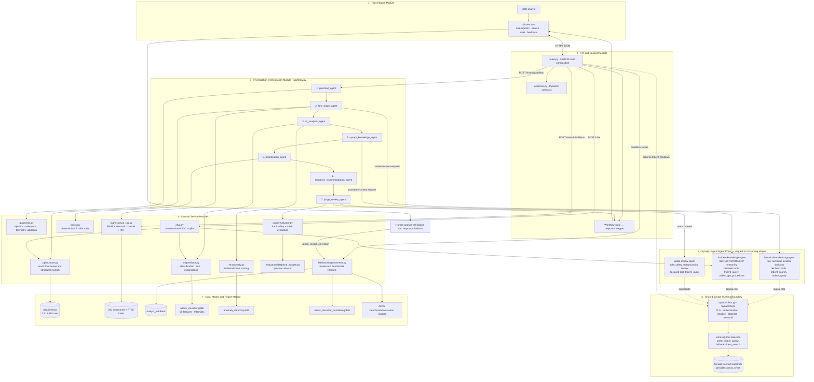
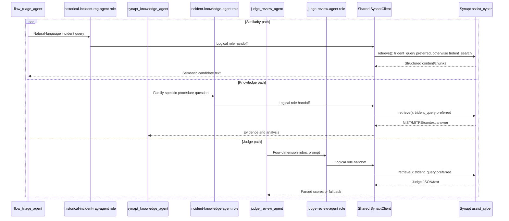

# CyberSentinel Copilot — Module-Wise Architecture with Synapt Agent Flow

This view groups the project by executable module and aligns each Synapt role with the investigation stage that consumes it. The three Synapt agents shown in the dashboard are logical read-only roles; the current Python runtime sends their retrieval requests through one shared `SynaptClient` and one configured Synapt provider.

## Module-wise architecture

## Main request flow by module

| Order | Orchestration stage | Python module/service | Synapt alignment | Data/model dependency | Output |
|---:|---|---|---|---|---|
| 1 | API entry | `main.py`, `schemas.py` | None | Request contracts | Validated investigation request |
| 2 | `guardrail_agent` | `guardrails.py` | Provider call blocked for rejected text | Regex and telemetry policy | Passed/rejected state |
| 3 | `flow_triage_agent` | `sqlite_store.py`, `rag/historical_rag.py` | `historical-incident-rag-agent` logical role | Flows, incident summaries, FTS5 | Target flow and ranked similar incidents |
| 4 | `ml_analysis_agent` | `ml/predictor.py`, `ml/anomaly.py` | None | Classifier and anomaly bundles | Family, risk, deviations, anomaly, MITRE |
| 5 | `synapt_knowledge_agent` | `synapt/client.py` | `incident-knowledge-agent` logical role | Synapt provider knowledge corpus | Procedures, ATT&CK context, verification steps |
| 6 | `prioritization_agent` | `policy.py` | None | Prediction/anomaly state | P1–P4 priority, rationale, missing context |
| 7 | `response_recommendation_agent` | `workflow.py` response builder | Uses previously retrieved knowledge | State, provenance, limitations | Investigation and response package |
| 8 | `judge_review_agent` | `judge/evaluator.py`, `evaluation/deepeval_adapter.py` | `judge-review-agent` logical role | Candidate package and observed telemetry | Safety/quality verdict |
| 9 | Response mapping | `main.py`, `schemas.py` | None | Final LangGraph state | `FlowInvestigationResponse` |
| 10 | Human review | `ui/index.html`, feedback routes | Optional provider feedback tool | `analyst_feedback` | Analyst decision and reviewed feedback |

## Aligned Synapt agent flow

## Important runtime alignment note

`/api/synapt/agents` reads three environment entries and presents their names, status, scope, and declared tools. The investigation code does not currently select a different credential or MCP connection for each role. `HistoricalIncidentRAG`, `synapt_knowledge_agent`, `ResponseJudge`, and `ChatService` all use the same `SynaptClient.retrieve()` method, which discovers provider tools and prefers `trident_query` whenever it is available. The diagram therefore distinguishes logical role alignment from the physical shared-client/provider flow.

## Supporting module flows

| API path | Modules | Synapt role/path | Local dependencies |
|---|---|---|---|
| `/search/incidents` | `main.py` → `sqlite_store.py` + `HistoricalIncidentRAG` | Historical RAG role through shared client | Flows + FTS5 summaries |
| `/chat` | `main.py` → `ChatService` | Knowledge role through shared client | Flow store + classifier + MITRE map |
| `/feedback` | `main.py` → `ContinuousImprovementEngine` | Direct optional `trident_feedback`; not one of the read-only role flows | Feedback table |
| `/feedback/review` | `ContinuousImprovementEngine` | None | Feedback status |
| `/feedback/improve` | `ContinuousImprovementEngine` | None | Accepted feedback + flows + active model |
| `/health` | `main.py`, `SQLiteIncidentStore` | Configuration status only | SQLite + loaded model objects |
| `/api/synapt/agents` | `main.py` | Displays the three logical roles | Environment entries |

## Module boundaries

- `workflow.py` owns sequencing and state movement; it does not own database access, model fitting, or provider transport.
- `sqlite_store.py` owns exact record evidence; `HistoricalIncidentRAG` owns selected-summary retrieval.
- Local ML produces probabilistic predictions. `policy.py` converts those outputs into deterministic priority.
- The Synapt roles supply read-only context and review. They do not execute containment or mutate infrastructure.
- The response module drafts actions, and the analyst owns the final decision.
