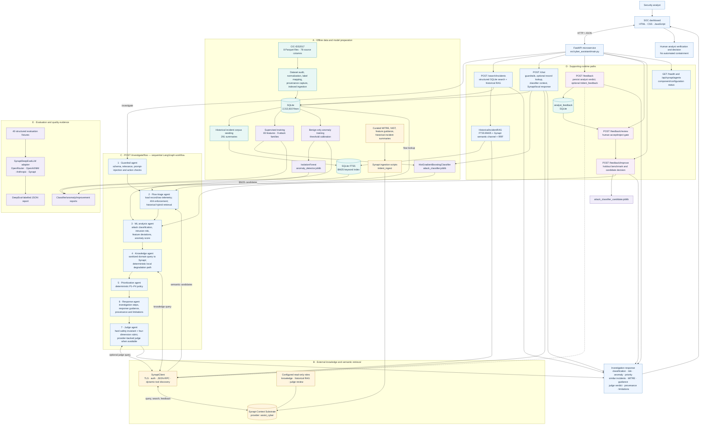

# CyberSentinel Copilot — Full Project Architecture

This document describes the architecture implemented in the current workspace. It separates offline preparation, runtime request handling, the seven-stage investigation workflow, supporting API paths, external knowledge retrieval, evaluation, and analyst-controlled improvement.

For the full layer-by-layer design, numbered input/processing/output matrix, branch sequence, endpoint map, trust boundaries, and failure paths, see [`DETAILED_ARCHITECTURE_AND_FLOW.md`](DETAILED_ARCHITECTURE_AND_FLOW.md).

For the module ownership view with the historical RAG, incident-knowledge, and judge-review Synapt roles aligned to their consuming workflow stages, see [`MODULE_WISE_SYNAPT_ARCHITECTURE.md`](MODULE_WISE_SYNAPT_ARCHITECTURE.md).

For the panel-ready narrative that starts with analyst input, continues through the frontend, backend, seven agents, aligned Synapt roles/tools, and ends with the final frontend result and reviewed feedback, see [`PRESENTATION_END_TO_END_ARCHITECTURE.md`](PRESENTATION_END_TO_END_ARCHITECTURE.md).

## Overall architecture

## Architectural responsibilities

| Layer | Responsibility | Primary implementation |
|---|---|---|
| Analyst interface | Collect investigation/search/chat input and render results | `src/cyber_assistant/ui/index.html` |
| API boundary | Validate request bodies, dispatch routes, shape responses | `src/cyber_assistant/main.py`, `schemas.py` |
| Orchestration | Run the seven investigation stages in order | `workflow.py` |
| Structured evidence | Preserve full flow telemetry and provenance; perform exact filters | `sqlite_store.py`, SQLite |
| Historical retrieval | BM25 keyword retrieval, Synapt semantic retrieval, reciprocal-rank fusion | `rag/historical_rag.py` |
| Prediction | Classify attack family, compute intrusion risk, explain deviations, score anomalies | `ml/predictor.py`, `ml/anomaly.py` |
| Knowledge | Retrieve security procedures and contextual guidance | `synapt/client.py`, Synapt MCP |
| Decision policy | Assign operational P1–P4 priority using explicit rules | `policy.py` |
| Output validation | Enforce hard action-safety rules and score the response rubric | `judge/evaluator.py` |
| Continuous improvement | Store feedback, require review, benchmark a candidate, record decision | `feedback/improvement.py` |
| Evaluation | Provide the DeepEval model adapter, fixtures, and JSON quality reports | `evaluation/deepeval_adapter.py`, `tests/test_deepeval_benchmarks.py` |

## Verified implementation boundaries

- The local CIC-IDS2017 export has no source/destination IP, source/destination port, Flow ID, or timestamp columns. Those request fields are accepted for interface compatibility but cannot filter this dataset; the API returns an explicit limitation.
- The RAG path fuses semantic scores only when Synapt text can be correlated with a keyword candidate. If too few candidates remain, the implementation pads results with random corpus records, so every returned fallback record is not guaranteed to be semantically similar.
- The judge uses an external model when configured and parseable; otherwise it falls back to fixed rubric defaults plus deterministic safety checks.
- The evaluation test creates `LLMTestCase` objects, but its stored score is currently a fixed `0.95` for locally accepted cases. The report proves fixture execution and the safety gate, not live DeepEval faithfulness or relevancy measurement.
- The improvement cycle creates a candidate artifact by copying the active bundle and compares equal predictions. It counts accepted corrections but does not fit those corrections into a new model, so “promoted” currently means candidate packaging and benchmark completion rather than learned model improvement.
- `/health` verifies SQLite availability. Its Synapt text is based on configuration presence and is not a live provider request.

## Safety and data boundaries

SQLite remains the source of truth for the 2.3 million network-flow records. Synapt receives questions, curated context, and selected summaries rather than the full raw flow corpus. The application produces decision support only: containment steps are drafts, automated blocking/isolation is prohibited, and a human analyst owns the final decision.
