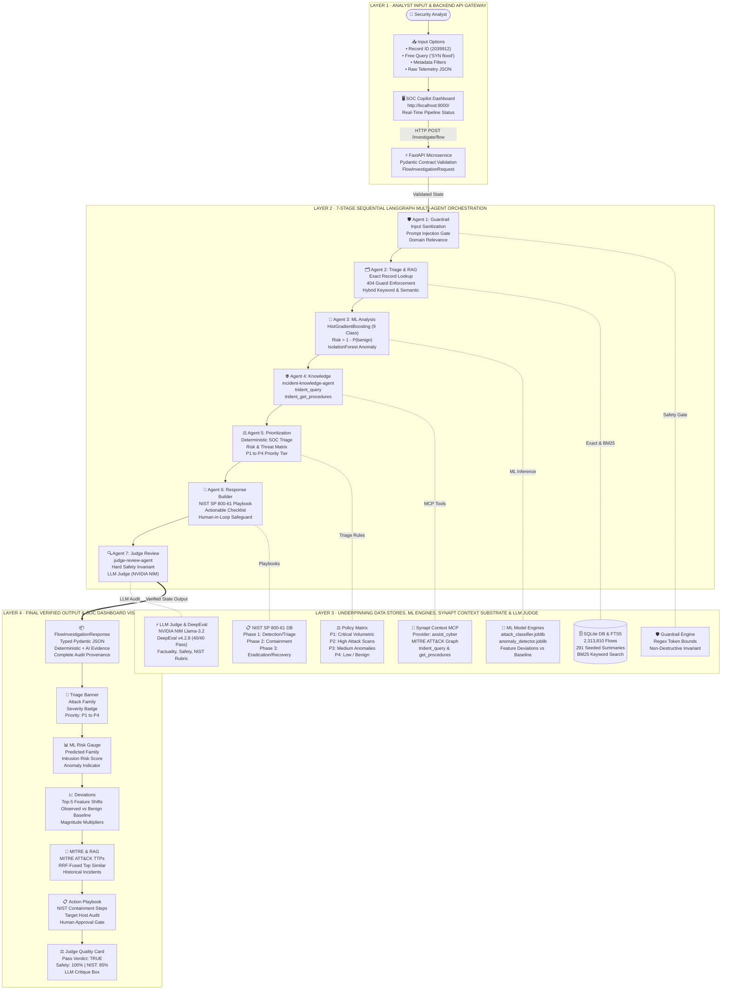

# CyberSentinel Copilot — End-to-End Presentation Architecture & Flow

This document provides the formal, end-to-end presentation architecture for the **AI-Powered Cybersecurity Incident Response Assistant with Synapt Context Substrate**. It illustrates the complete flow starting from **User Input at the Frontend**, through the **FastAPI Backend Gateway**, into the **7-Stage Sequential LangGraph Multi-Agent Orchestration**, interacting with the **Local Data/ML Engines**, **Synapt MCP Context Substrate**, and **External LLM Judge**, through to the **Final Output Visualization** on the SOC Dashboard.

---

## 1. End-to-End System Architecture Diagram

> [!TIP]
> **High-Resolution & Interactive Versions Available:**
> - [Interactive Zoom & Pan HTML Viewer](architecture/presentation_flow_diagram.html)
> - [High-Resolution PNG (3000x2050)](architecture/presentation_flow_diagram.png)
> - [Scalable Vector SVG](architecture/presentation_flow_diagram.svg)
> - [Vector PDF Handout](architecture/presentation_flow_diagram.pdf)
> - [Raw Mermaid Source](architecture/presentation_flow_diagram.mmd)

---

## 2. Step-by-Step Flow Matrix: From User Input to Final Output

| Step | Processing Node / Component | Input Received | Exact Tools & Engines Invoked | Output Produced |
| :---: | :--- | :--- | :--- | :--- |
| **1** | **User Input (Frontend)** | User clicks/types in Dashboard | Browser DOM & Fetch API | HTTP Request to `POST /investigate/flow` |
| **2** | **FastAPI Backend Gateway** | Raw JSON Payload | `Pydantic` validation (`FlowInvestigationRequest`) | Validated investigation state passed to LangGraph |
| **3** | **Agent 1: Guardrail Agent** | Request strings & telemetry | Regex guardrails, injection filters, schema checks | `guardrail_status: "passed"` (or blocks injection) |
| **4** | **Agent 2: Flow Triage & Hybrid RAG** | `record_id` / raw telemetry | 1. `SQLiteIncidentStore.get_flow()` 2. SQLite FTS5 (BM25 keyword search) 3. Synapt MCP: `trident_search` / `trident_query` 4. Reciprocal Rank Fusion (RRF) | Target telemetry extracted + Top-5 semantically similar historical incidents |
| **5** | **Agent 3: ML Analysis Agent** | Target flow feature vector (65 numerical features) | 1. `HistGradientBoostingClassifier` 2. `IsolationForest` 3. Feature Baseline Deviations Engine | Predicted attack family (e.g. `port_scan`), Intrusion Risk (`1 - P_benign`), Anomaly Score, Top 5 Deviations |
| **6** | **Agent 4: Synapt Knowledge Agent** | Predicted attack family + observed indicators | 1. Synapt MCP: `trident_query` 2. Synapt MCP: `trident_get_procedures` *(Falls back to deterministic NIST playbooks if offline)* | Grounded threat narrative, MITRE ATT&CK techniques (e.g., T1046), and recommended procedure references |
| **7** | **Agent 5: Prioritization Agent** | Attack family, risk probability, anomaly state | Deterministic P1–P4 triage decision matrix | Priority Level (`P1` Critical, `P2` High, `P3` Medium, `P4` Low) with explicit missing context disclosures |
| **8** | **Agent 6: Response Recommendation Agent** | Aggregated evidence from Steps 3–7 | NIST SP 800-61 framework (Detection, Containment, Eradication, Recovery) | Structured checklist of investigation steps and safe human-in-the-loop response recommendations |
| **9** | **Agent 7: Judge Review Agent** | Generated guidance + observed telemetry | 1. Hard safety checks (rejects automated blocking) 2. `ResponseJudge` + `SynaptDeepEvalLLM` 3. NVIDIA NIM (`meta/llama-3.2-11b-vision-instruct`) | Structured `JudgeVerdict` containing composite score (0–100%), safety score (100%), NIST score, and critique |
| **10** | **Final Presentation (Frontend)** | Structured JSON response | Web UI rendering engine (`src/cyber_assistant/ui/index.html`) | Full analytical report, interactive cards, visual pipeline status, and Judge Quality Audit Card |

---

## 3. Explicit Tool & Substrate Traceability

### A. Synapt Context Substrate MCP Tools
* **`trident_query`**: Natural language querying over the curated cybersecurity knowledge graph and incident corpus.
* **`trident_search`**: Semantic vector similarity retrieval across historical incident embeddings.
* **`trident_get_procedures`**: Retrieval of standardized, reviewed Standard Operating Procedures (SOPs).
* **`trident_feedback`**: Live synchronization of analyst feedback into the Synapt platform for continuous knowledge improvement.
* **`trident_ingest` / `trident_get_schema`**: Administration and schema inspection tools for onboarded data.

### B. Synapt Onboarded Read-Only Agents
1. **`incident-knowledge-agent`**: Assigned to NIST SP 800-61 Playbooks & MITRE Reasoning.
2. **`historical-incident-rag-agent`**: Assigned to Historical Incident Semantic Correlation.
3. **`judge-review-agent`**: Assigned to Quality & Safety Output Review.

### C. Local Analytical & ML Engines
* **SQLite Database**: 2,313,810 real network flows from CIC-IDS2017.
* **SQLite FTS5**: Full-Text Search (BM25) over 291 representative incident summaries.
* **`attack_classifier.joblib`**: Supervised HistGradientBoosting classifier (9 attack families, 65 network features).
* **`anomaly_detector.joblib`**: Unsupervised Isolation Forest trained on benign network traffic.
* **Benign Feature Baseline**: Statistical baseline calculating relative feature shifts for explainability.

### D. LLM-as-a-Judge & Benchmark Substrate
* **NVIDIA NIM API**: OpenAI-compatible endpoint running `meta/llama-3.2-11b-vision-instruct` for rubric scoring.
* **DeepEval v4.2.8**: Benchmark suite evaluating 40 test cases across live telemetry, synthetic fixtures, and safety guardrails.

---

## 4. Key Talking Points for the Panel Presentation

1. **Human-in-the-Loop Analyst Aid (Non-Destructive Principle):**
   * The system acts strictly as an **investigative decision-support aid**. It explicitly **refuses automated containment** (such as automatic firewall rule generation or host isolation), ensuring human authority at all times.
2. **True Hybrid Intelligence:**
   * Combines **deterministic verification** (SQLite queries, exact feature calculations), **machine learning** (supervised classification + anomaly detection), and **semantic reasoning** (Synapt Knowledge Graph + LLM-as-a-Judge).
3. **Multi-Agent Orchestration via LangGraph:**
   * Rather than a monolithic prompt, the investigation is decomposed into 7 specialized agent stages with strictly typed state transitions and safety gates.
4. **Independent LLM Judge & Zero Hallucination Risk:**
   * Every generative output passes through an independent judge before being presented to the analyst, verifying evidence grounding and NIST alignment.
