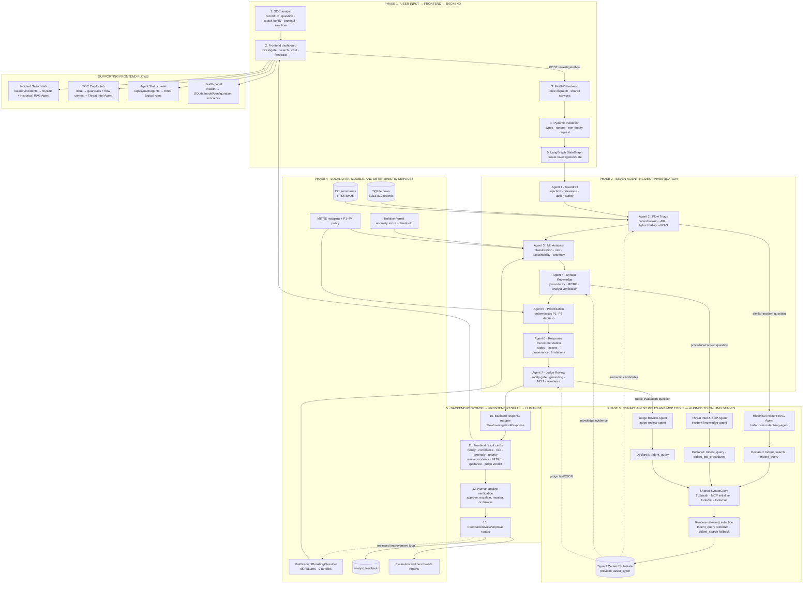
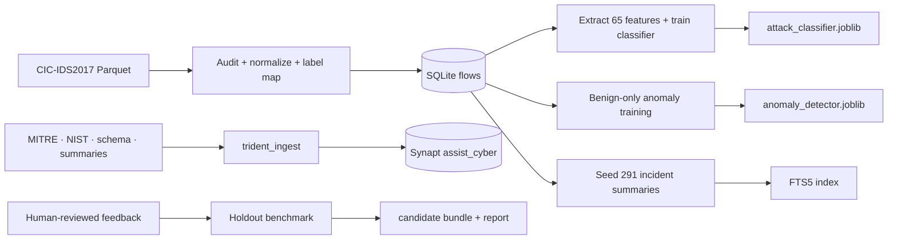

# CyberSentinel Copilot — Presentation Architecture: User Input to Final Output

This is the recommended architecture for the panel presentation. Read the main flow from left to right in each numbered band: the analyst enters an incident in the frontend, FastAPI validates it, LangGraph moves it through seven investigation agents, the relevant Synapt roles use MCP tools through the shared provider client, and the completed evidence package returns to the frontend for a human decision.

## Presentation architecture

## Exact presentation flow

1. The **SOC analyst** enters a record ID, security question, attack family, protocol, or raw flow in the frontend dashboard.
2. The **frontend** sends the request to `POST /investigate/flow` in the FastAPI backend.
3. **Pydantic** validates field types, bounds, lengths, and the requirement that at least one investigation input is present.
4. FastAPI creates the initial **LangGraph `InvestigationState`** and starts the seven-agent pipeline.
5. **Agent 1 — Guardrail:** detects prompt injection, destructive instructions, prohibited automated containment, and off-topic query-only input.
6. **Agent 2 — Flow Triage:** loads an exact SQLite record or validates raw telemetry, returns a real 404 for an unknown record, and invokes `HistoricalIncidentRAG`.
7. The triage path uses local **FTS5/BM25** and the logical **Historical Incident RAG Agent**. Its declared Synapt tools are `trident_search` and `trident_query`.
8. **Agent 3 — ML Analysis:** executes the `HistGradientBoostingClassifier`, calculates risk as `1 - P(benign)`, finds the largest benign-baseline deviations, runs `IsolationForest`, and attaches MITRE mappings.
9. **Agent 4 — Synapt Knowledge:** sends sanitized attack-family context to the logical **Threat Intel & SOP Agent**. Its declared tools are `trident_query` and `trident_get_procedures`.
10. **Agent 5 — Prioritization:** applies the deterministic P1–P4 policy using family, risk, anomaly state, and available context.
11. **Agent 6 — Response Recommendation:** assembles investigation steps, response drafts, provenance, and limitations. It performs no containment action.
12. **Agent 7 — Judge Review:** applies a hard action-safety gate and evaluates factual grounding, action safety, NIST alignment, and relevance. It is aligned with the logical **Judge Review Agent**, whose declared tool is `trident_query`.
13. The judge returns the final state to FastAPI, which maps it into `FlowInvestigationResponse`.
14. The frontend renders classification, confidence, risk, anomaly, priority, explanations, similar incidents, MITRE techniques, guidance, provenance, limitations, and judge verdict.
15. The analyst verifies the evidence and chooses whether to monitor, escalate, dismiss, or manually approve a response.
16. Feedback is stored for human review and the separate improvement benchmark lifecycle.

## Synapt runtime clarification

The three named Synapt agents are logical roles displayed by the UI and `/api/synapt/agents`. The current workflow does not instantiate three separate Python clients or route using the three environment tokens. Historical RAG, knowledge retrieval, judge evaluation, and chat share `SynaptClient.retrieve()`, which performs MCP discovery and selects `trident_query` whenever available, falling back to `trident_search`. `trident_get_procedures` is declared for the knowledge role but is not directly invoked by the current investigation workflow.

## Technology and tool chain

| Flow area | Technology/tool |
|---|---|
| Frontend | HTML, CSS, JavaScript dashboard |
| Backend API | FastAPI, Pydantic |
| Agent orchestration | LangGraph `StateGraph` |
| Structured evidence | SQLite |
| Keyword retrieval | SQLite FTS5/BM25 |
| Semantic/context retrieval | Synapt MCP through `SynaptClient` |
| Synapt tools | `trident_query`, `trident_search`, displayed `trident_get_procedures`, optional `trident_feedback`, offline `trident_ingest` |
| Attack prediction | Scikit-learn `HistGradientBoostingClassifier` |
| Anomaly prediction | Scikit-learn `IsolationForest` |
| Explainability | Benign-baseline feature deviation calculation |
| Priority | Deterministic Python P1–P4 policy |
| Judge | Hard deterministic safety gate plus provider-backed/fallback rubric |
| Evaluation | DeepEval adapter, JSON fixtures and reports |
| Feedback | SQLite review lifecycle and candidate benchmark report |

## Supporting preparation flow

