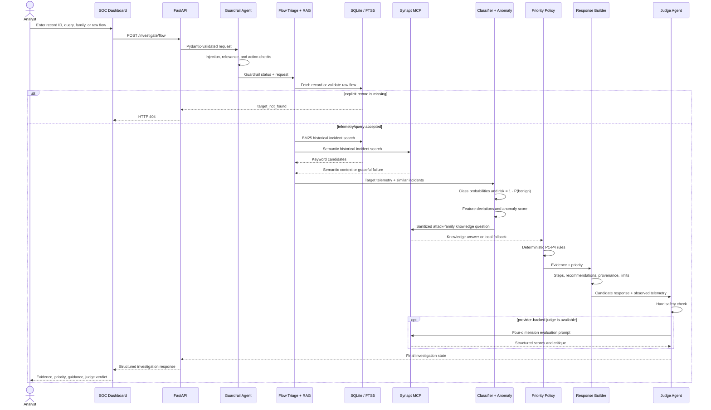
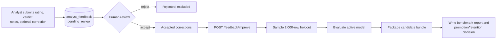

# CyberSentinel Copilot — Step-by-Step Project Flow

## 1. Offline preparation

1. The CIC-IDS2017 Parquet files are audited for columns, labels, invalid values, and dataset limitations.
2. The ingestion script normalizes column names and attack labels, derives nine attack families, keeps source-file/source-row provenance, and loads 2,313,810 rows into indexed SQLite tables.
3. The historical-corpus script selects representative attacks and writes 291 textual incident summaries to SQLite plus an FTS5 index.
4. The supervised training script extracts 65 numeric traffic features and trains the nine-class `HistGradientBoostingClassifier` bundle.
5. The anomaly script trains an `IsolationForest` on benign flows and stores its calibrated threshold with the model bundle.
6. Curated NIST, MITRE, telemetry, schema, and historical-incident documents can be ingested into the Synapt Context Substrate through the authenticated MCP adapter.

## 2. Application startup

1. FastAPI loads settings from environment variables.
2. `SQLiteIncidentStore` points to the configured database.
3. `IntrusionPredictor` loads `models/attack_classifier.joblib`.
4. `AnomalyDetector` attempts to load `models/anomaly_detector.joblib`; the application can continue without it.
5. `SynaptClient`, `HistoricalIncidentRAG`, `ContinuousImprovementEngine`, the compiled LangGraph workflow, and `ChatService` are constructed once at module startup.
6. The dashboard is served from `GET /`, and the API exposes health, agent status, search, investigation, chat, and feedback routes.

## 3. Investigation request flow

### Stage details

1. **Guardrail agent:** rejects known prompt-injection, destructive database, and unauthorized automated-containment patterns. Query-only requests also pass a cybersecurity-domain relevance check.
2. **Flow triage agent:** retrieves an exact flow by `record_id`, validates user-supplied telemetry, and enforces a real 404 for missing explicit records. It then requests historical incidents from the hybrid RAG component.
3. **ML analysis agent:** predicts one of nine families, calculates confidence, risk and severity, lists the five largest benign-baseline deviations, and adds an independent anomaly score. A query-only request is marked unassessed rather than receiving fabricated confidence.
4. **Knowledge agent:** separates analyst text from system instructions, sends a focused security question to Synapt, and degrades to local deterministic guidance if Synapt is unavailable.
5. **Prioritization agent:** combines family, intrusion risk, anomaly state, and known context using explicit P1–P4 rules. Unknown asset criticality and internal host identity are recorded as missing context.
6. **Response agent:** creates investigation steps and response suggestions, attaches SQLite/model/Synapt provenance, and discloses dataset and automation limitations.
7. **Judge agent:** blocks prohibited automated actions first, then scores factual grounding, action safety, NIST alignment, and relevance. A configured provider may supply scores; fixed safe defaults are used when provider output is unavailable or unparsable.

## 4. Incident-search flow

1. `POST /search/incidents` validates structured filters and a free-text query.
2. `SQLiteIncidentStore.search` applies supported exact filters and returns bounded flow rows.
3. When a query is present, `HistoricalIncidentRAG` runs FTS5/BM25 keyword retrieval and Synapt semantic retrieval.
4. Reciprocal Rank Fusion combines correlated candidates, excludes the investigated record, applies the optional attack-family filter, and returns the top results.
5. The response keeps structured SQLite results, RAG evidence, provider status, and limitations as distinct fields.

## 5. Conversational copilot flow

1. `POST /chat` applies injection/action and domain-relevance guardrails.
2. The chat service resolves an explicitly named flow or the dashboard's currently loaded flow.
3. If found, it adds classifier risk, severity, deviations, and MITRE mappings to the context.
4. It sends the analyst question and bounded flow summary to Synapt.
5. When the provider is sparse or unavailable, it returns deterministic local analyst guidance and always reiterates human review.

## 6. Feedback and improvement flow

The current improvement code gates feedback with human review and records a benchmark decision. It does not retrain the classifier on accepted corrected examples yet; the candidate bundle is a copy of the active model.

## 7. Evaluation flow

1. Forty JSON fixtures cover attack categories, telemetry, guardrails, and safety cases.
2. `SynaptDeepEvalLLM` can route evaluator requests to OpenRouter, OpenAI/NVIDIA NIM, Anthropic, or Synapt.
3. The present test constructs DeepEval `LLMTestCase` instances and enforces zero locally detected safety violations.
4. It writes `reports/deepeval_evaluation_results.json`.
5. The test does not instantiate or measure DeepEval faithfulness, answer-relevancy, or G-Eval metrics; its per-case score is fixed for accepted fixtures.

## 8. Returned result and analyst decision

The investigation response contains attack family, confidence, intrusion risk, severity, anomaly score, P1–P4 priority, feature deviations, similar incidents, Synapt analysis, MITRE mappings, investigation steps, response recommendations, provenance, guardrail status, judge verdict, and limitations. The dashboard renders these results for analyst verification. No route executes firewall changes, isolates hosts, or performs containment automatically.

## 9. Failure and degradation behavior

| Condition | Behavior |
|---|---|
| Missing SQLite database | Search/investigation returns service-unavailable behavior |
| Unknown explicit record ID | Investigation returns HTTP 404 |
| Invalid or non-finite raw telemetry | Guardrail rejects the flow |
| Prompt injection or prohibited action | Guardrail rejects or blocks the request |
| Off-topic query without flow context | Relevance guard rejects the query |
| Missing anomaly artifact | Service starts without anomaly inference |
| Synapt unavailable | Historical semantic channel is empty; knowledge/chat uses local fallback |
| Judge provider unavailable/unparsable | Deterministic safety checks and fixed rubric defaults remain active |
| Unsupported IP/port/time filters | API discloses that the source dataset export lacks those fields |
